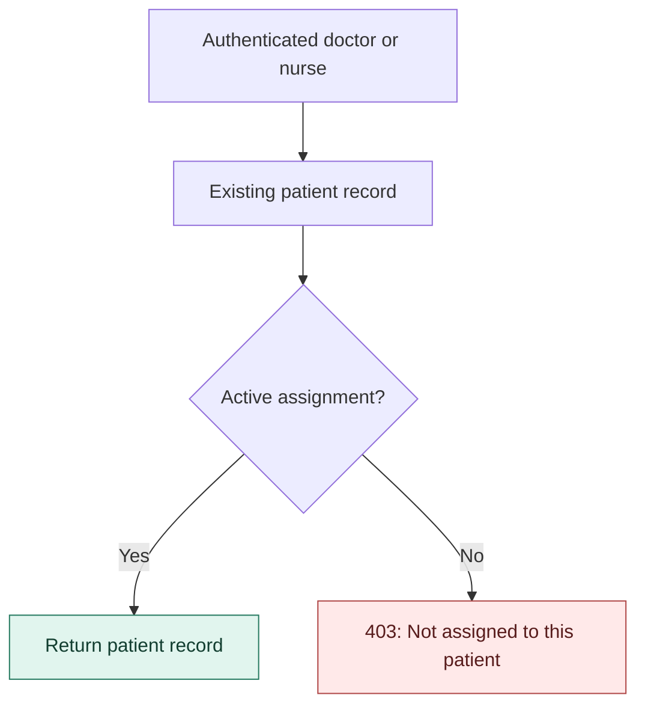
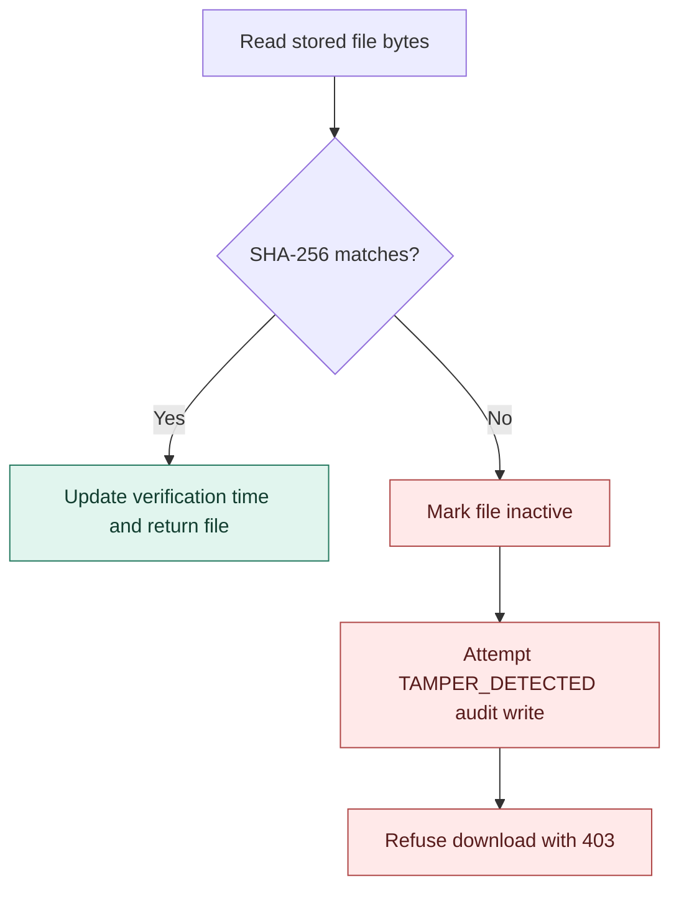
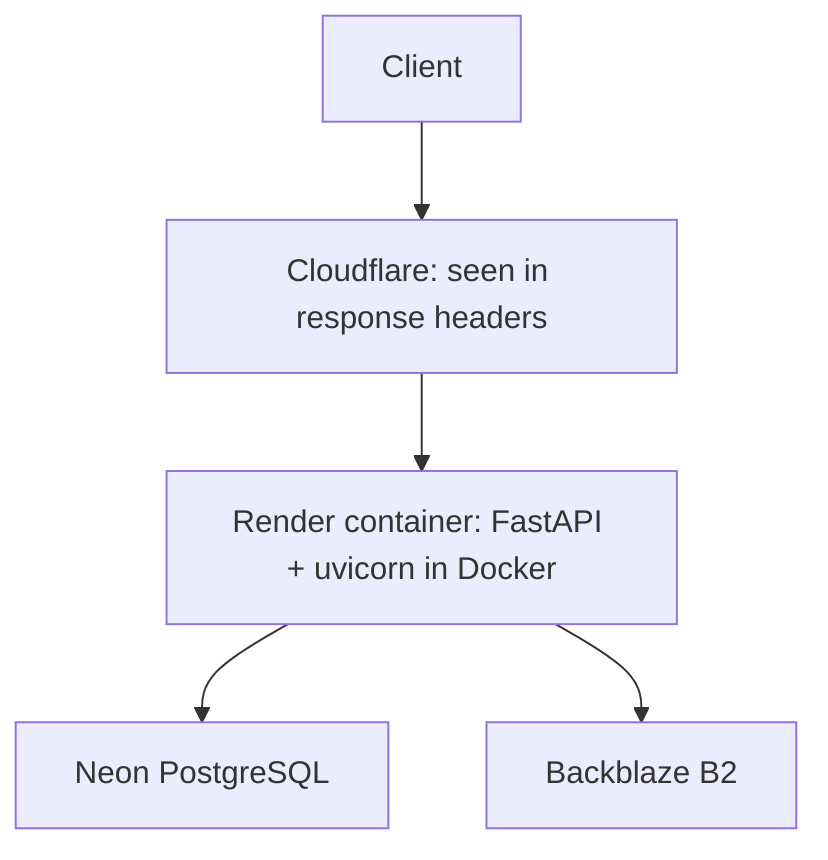

# Medical Integrity System

A FastAPI backend that restricts medical-record access by patient assignment and checks stored files for changes before download.

[](https://github.com/Kartik-Budhlakoti/medical-integrity-system/actions/workflows/ci.yml)
[](https://github.com/Kartik-Budhlakoti/medical-integrity-system/actions/workflows/security.yml)

**Synthetic data only. Not a certified medical system. No healthcare-compliance claim.**

The idea came from watching thriller movies where a hospital system fails because someone changes a record or skips a log entry, and I asked myself whether I could build something that notices that. This solo project keeps an audit log of selected actions and compares each stored file's SHA-256 hash on every download, so a changed file is refused and logged. The hardest part was the data model: I only had basic DBMS from college, and I had to design and connect many tables myself. Re-running manual smoke tests for every edge case stopped scaling, which is why it now has 430 automated tests. It is a portfolio project that shows data-integrity ideas, not a system ready for real patient data.

The API manages staff accounts, patient assignments, treatment and nursing notes, file uploads, and audit events. Doctors write treatment notes; nurses write care notes and optional vital signs. Note authors come from the authenticated account.

Sources: [API routers](app/main.py), [treatment notes](app/routers/treatment_note.py), [nursing notes](app/routers/nursing_note.py).

## Patient access

An active account and the correct role are not enough: doctors and nurses must also be assigned to the patient. Creating a patient does not automatically assign the creator.



| Role | Can create accounts for | Patient, note, and file access |
| --- | --- | --- |
| SuperAdmin | Admin, Doctor, Nurse | No clinical access |
| Admin | Doctor, Nurse only | All patients; manages assignments and file invalidation |
| Doctor | Nobody | Assigned patients; creates treatment notes |
| Nurse | Nobody | Assigned patients; creates nursing notes |

No role can create a SuperAdmin through `/users/create`; the first SuperAdmin is created only through the token-protected bootstrap endpoint.

SuperAdmin or Admin can deactivate users; an Admin cannot deactivate another Admin, a SuperAdmin cannot be deactivated, and the last active Admin cannot be deactivated. Self-deactivation is also blocked.

Patient updates are field-restricted: Admin changes admission, emergency status and chief complaint; Doctor changes emergency status and chief complaint; Nurse changes height and weight. Doctors and nurses also need an active assignment.

Sources: [patient routes](app/routers/patient.py), [assignments](app/routers/assignment.py), [account creation/deactivation](app/routers/user.py), [bootstrap](app/routers/bootstrap.py).

## File integrity

A SHA-256 fingerprint is saved at upload and compared with the stored bytes at download. This branch runs after access checks and successful retrieval of the file and reference hash.



A mismatch returns **403 — `File integrity verification failed`**. `get_file()` detects it; `log_action()` writes the audit row. Audit persistence is best-effort. A hash match is neither encryption nor a malware scan and depends on a trustworthy reference hash.

Uploads accept PDF, PNG, JPEG, and DICOM extensions with matching signatures, up to **50 MiB**; the size check occurs after reading the upload into memory. Manual file invalidation is Admin-only. Invalidated files remain recorded but cannot be downloaded through the API.

Sources: [file routes](app/routers/file.py), [SHA-256 helper](app/core/integrity.py), [audit writer](app/core/audit.py).

## Stack

| Layer | Technology and purpose |
| --- | --- |
| API | Python 3.14, FastAPI, Pydantic — routes and request validation |
| Data | PostgreSQL, SQLAlchemy, Alembic — records, relationships, and migrations |
| Authentication | JWT bearer tokens and bcrypt password hashing |
| Files | Local filesystem or Backblaze B2 object storage |
| Rate limiting | SlowAPI; Valkey locally, memory fallback when `VALKEY_URL` is absent |
| Packaging | Docker; non-root runtime; migrations before server startup |

Sources: [dependencies](requirements.txt), [Dockerfile](Dockerfile), [Compose](docker-compose.yml), [startup](scripts/start.sh), [authentication](app/core/dependencies.py), [storage](app/core/storage.py), [limiter](app/core/limiter.py).

## Live deployment

Cloudflare appears in front of Render in the response headers; I did not set it up.



Production request path. Local development uses Docker Compose with PostgreSQL and Valkey.

Smoke test on the deployed service (2026-11-04): 10 of 10 steps passed - login, create user and patient, upload to Backblaze B2 and download with a matching SHA-256, and a deactivated account refused at login.

A forged `X-Forwarded-For` header was ignored; the client address recorded in `audit_logs` matched the real one.

Sources: [live observations](docs/known-issues.md), [deployment decisions](docs/decisions-log.md).

## DevSecOps pipeline

| Check | Configuration |
| --- | --- |
| `lint` | Ruff checks |
| `test` | Pytest with PostgreSQL; separate migration upgrade and schema comparison |
| `docker` | Builds the application image; does not run it |
| `bandit` | Scans `app/` for medium-severity findings and above |
| Trivy | Scans the built image for known vulnerabilities and secrets; fixable HIGH and CRITICAL findings fail the job; unfixed ones are ignored. |
| CodeQL | GitHub default setup for Python and workflow analysis |
| Dependabot | Quarterly pip and monthly Actions/Docker version updates, seven-day cooldown, and documented dependency exclusions |

The Trivy action is pinned by commit SHA and Python dependencies are pinned to exact versions.

The configured required checks on `main` are **`lint`, `test`, `docker`, and `bandit`**. Trivy is a scan gate, **not a required merge check**; CodeQL is also non-required. CI and Trivy run on pull requests and pushes to `main`; Trivy additionally runs Mondays at 03:00 UTC.

Recorded test run: **430 tests pass; 14 strict-xfail cases cover known bugs.** Strict markers make unexpected successes fail until the markers are removed. Tests recreate a dedicated local database ending in `_test`; they must not target operational data.

Sources: [CI](.github/workflows/ci.yml), [Trivy](.github/workflows/security.yml), [Dependabot](.github/dependabot.yml), [security decisions](docs/decisions-log.md), [test results](docs/known-issues.md), [test fixtures](tests/conftest.py).

## Run locally

Install Git and Docker with the Compose plugin, start Docker, and make ports 8000 and 5432 available. Compose binds the API to `127.0.0.1:8000`, so it is reachable only from the machine running Docker.

```bash
git clone https://github.com/Kartik-Budhlakoti/medical-integrity-system.git
cd medical-integrity-system
cp .env.example .env
```

Edit `.env`; never commit it. `POSTGRES_USER` and `POSTGRES_DB` can be any simple lowercase names.

Generate a separate value for each of `SECRET_KEY`, `BOOTSTRAP_TOKEN`, `VALKEY_PASSWORD`, and `POSTGRES_PASSWORD` by running one of these generators once per secret. Hex is URL-safe, which matters because passwords go into connection URLs.

```bash
openssl rand -hex 32
```

Alternatively:

```bash
python3 -c "import secrets; print(secrets.token_hex(32))"
```

Set `ALGORITHM=HS256`, `ACCESS_TOKEN_EXPIRE_MINUTES=30`, and `STORAGE_BACKEND=local` in `.env`.

Leave `DATABASE_URL` blank: Compose builds the API's `DATABASE_URL` and `VALKEY_URL` from `POSTGRES_USER`, `POSTGRES_PASSWORD`, `POSTGRES_DB`, and `VALKEY_PASSWORD`.

The four B2 values (`B2_ENDPOINT_URL`, `B2_KEY_ID`, `B2_APPLICATION_KEY`, and `B2_BUCKET_NAME`) can stay empty with local storage. To use Backblaze instead, set `STORAGE_BACKEND=b2` and fill the four B2 values.

```bash
docker compose up --build
```

Keep that terminal open. After migrations and startup finish, open **http://127.0.0.1:8000/health**. Expected response: `{"status":"ok"}`. This checks the API process, not database or storage connectivity.

Initialize the first SuperAdmin using `/bootstrap/superadmin` and `X-Bootstrap-Token`. The route closes itself once a SuperAdmin exists. The commands are under [First requests](#first-requests).

| Symptom | Explanation / action |
| --- | --- |
| `/docs` fails to load | The CSP blocks Swagger CDN assets; use an HTTP client. |
| Bootstrap returns 403 | Check the setup token and whether a SuperAdmin already exists. |
| Uploads disappear | With local storage, uploaded files live inside the API container. `docker compose down` deletes them while the database keeps the rows. Use `docker compose stop` and `docker compose start` instead; replacing the API container also loses its local uploads. |

Sources: [environment template](.env.example), [Compose](docker-compose.yml), [startup](scripts/start.sh), [health route](app/main.py), [bootstrap](app/routers/bootstrap.py), [known issues](docs/known-issues.md).

## First requests

<details>
<summary>Create a SuperAdmin and an Admin, add a patient, upload a file, and watch a change get detected</summary>

Run these in a second terminal, in the repository folder, while Compose is running. They were run against a fresh clone with the settings above. The ids below (patient 1, file 1) assume a new, empty database. The email addresses and the password are examples for local testing only.

Passwords need at least 8 characters, one uppercase letter, one digit and one special character, and at most 72 bytes. Tokens last `ACCESS_TOKEN_EXPIRE_MINUTES` (30 above), and login is limited to 5 per minute.

**1. Create the first SuperAdmin**

```bash
BOOT=$(grep '^BOOTSTRAP_TOKEN=' .env | cut -d= -f2)
curl -s -X POST http://127.0.0.1:8000/bootstrap/superadmin \
  -H "X-Bootstrap-Token: $BOOT" \
  -H "Content-Type: application/json" \
  -d '{"full_name":"Test SuperAdmin","email":"superadmin@example.com","password":"Demo_Pass-2026"}'
```

Expected: `{"message":"System initialized successfully"}`. This call also creates the four roles. On a new database their ids are 1 SuperAdmin, 2 Admin, 3 Doctor and 4 Nurse.

**2. Log in as SuperAdmin and create an Admin.** A SuperAdmin has no access to patients, so patient work needs an Admin.

```bash
SA=$(curl -s -X POST http://127.0.0.1:8000/auth/login -H "Content-Type: application/json" -d '{"email":"superadmin@example.com","password":"Demo_Pass-2026"}' | python3 -c "import sys, json; print(json.load(sys.stdin)['access_token'])")
curl -s -X POST http://127.0.0.1:8000/users/create -H "Authorization: Bearer $SA" -H "Content-Type: application/json" -d '{"full_name":"Test Admin","email":"admin@example.com","password":"Demo_Pass-2026","role_id":2}'
```

**3. Log in as the Admin and create a patient**

```bash
ADM=$(curl -s -X POST http://127.0.0.1:8000/auth/login -H "Content-Type: application/json" -d '{"email":"admin@example.com","password":"Demo_Pass-2026"}' | python3 -c "import sys, json; print(json.load(sys.stdin)['access_token'])")
curl -s -X POST http://127.0.0.1:8000/patients/create -H "Authorization: Bearer $ADM" -H "Content-Type: application/json" -d '{"full_name":"Test Patient","dob":"1990-01-01","height_cm":170,"weight_kg":70,"chief_complaint":"synthetic test","is_emergency":false}'
```

**4. Upload a small PDF and download it.** The two checksums match.

```bash
printf '%%PDF-1.4\nsynthetic test file\n' > /tmp/mis-test.pdf
curl -s -X POST http://127.0.0.1:8000/files/upload -H "Authorization: Bearer $ADM" -F "patient_id=1" -F "file_type=report" -F "file=@/tmp/mis-test.pdf;type=application/pdf"
curl -s -H "Authorization: Bearer $ADM" http://127.0.0.1:8000/files/1 -o /tmp/mis-down.pdf
sha256sum /tmp/mis-test.pdf /tmp/mis-down.pdf
```

**5. Change the stored copy and download it again.** This works with local storage (`STORAGE_BACKEND=local`), where the stored file is inside the API container.

```bash
FILE=$(docker compose exec -T api sh -c 'ls -t uploads | head -1')
docker compose exec -T api sh -c "echo tampered >> uploads/$FILE"
curl -s -H "Authorization: Bearer $ADM" http://127.0.0.1:8000/files/1
echo
curl -s -H "Authorization: Bearer $ADM" http://127.0.0.1:8000/files/1
echo
```

The first download returns `{"detail":"File integrity verification failed"}` and marks the file inactive. The second returns `{"detail":"File is invalidated"}`. The audit log records both:

```bash
docker compose exec postgres sh -c 'psql -U "$POSTGRES_USER" -d "$POSTGRES_DB" -c "select id, action, result from audit_logs order by id desc limit 4"'
```

The newest rows are `FILE_ACCESS_DENIED` and `TAMPER_DETECTED`.

</details>

## Rate limits

| Route | Limit per remote address |
| --- | --- |
| `POST /auth/login` | 5/minute |
| `POST /auth/change-password` | 5/minute |
| `POST /bootstrap/superadmin` | 3/minute |
| `POST /files/upload` | 10/minute |
| `GET /files/{file_id}` | 20/minute |

No other route has a configured default limit.

Sources: [authentication](app/routers/auth.py), [bootstrap](app/routers/bootstrap.py), [files](app/routers/file.py), [limiter](app/core/limiter.py), [account checks](app/core/dependencies.py).

## Known limits

- The `/docs` page does not load: Content-Security-Policy blocks the Swagger assets; use an HTTP client.
- PATCH with a null patient field returns 500.
- Treatment notes accept blank text.
- Login is faster for an email that does not exist.
- A wrong note cannot be corrected: there are no edit or delete routes.
- A password change does not end existing sessions; tokens stay valid until they expire.
- Rate-limit counters reset when the service restarts; they are in memory on Render.
- The Cloudflare address list in `scripts/start.sh` needs a manual refresh.
- The free Render plan sleeps after 15 minutes idle; the first request after idle took 22.9 s once (single measurement).
- There is no public demo login.
- The upload size limit is checked after the whole file is read into memory.

Sources: [known issues](docs/known-issues.md).

## Documentation

- [docs/decisions-log.md](docs/decisions-log.md) - why each design choice was made.
- [docs/known-issues.md](docs/known-issues.md) - known bugs and limits, with status.

## License

MIT License — Copyright (c) 2026 Kartik Budhlakoti.

Sources: [LICENSE](LICENSE).
